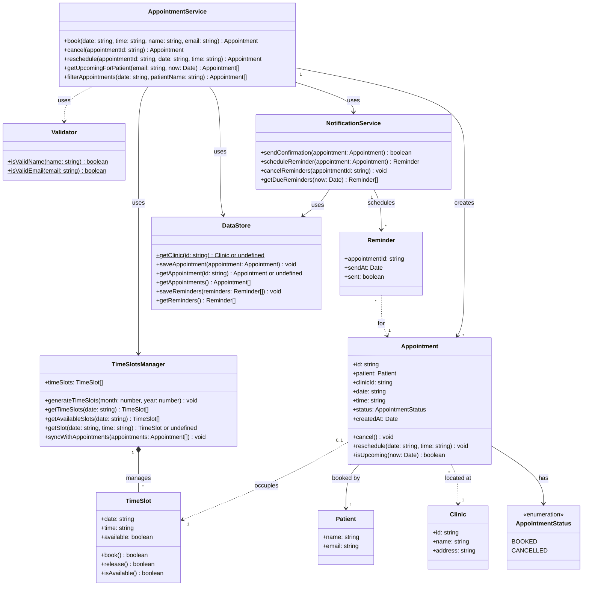

# MediLink class diagram

## Overview

This diagram outlines the main classes in MediLink, their methods, and how they interact. Team members can refer to it when implementing features that depend on classes owned by someone else.

`TimeSlot` and `TimeSlotsManager` already exist on the `alex/view-available-time-slots` branch. The other classes are proposed and still need to be reviewed by the team (issue #1).

## Classes and responsibilities

| Class | Responsibility | Status |
|---|---|---|
| `TimeSlot` | Represents one appointment time and whether it is available. | Existing |
| `TimeSlotsManager` | Generates the time slots for a month and finds available slots for a date. | Existing |
| `Patient` | Stores the name and email entered when booking. | Proposed |
| `Clinic` | Stores the clinic's name and address, shown in confirmations and upcoming appointments. | Proposed |
| `Appointment` | Represents one booking and its status. Handles cancelling and rescheduling. | Proposed |
| `AppointmentStatus` | Lists the possible states of an appointment. | Proposed |
| `Reminder` | Represents one reminder scheduled for an appointment. | Proposed |
| `Validator` | Checks that names and emails are valid before a booking is saved. | Proposed |
| `DataStore` | Saves and loads appointments and reminders. | Proposed |
| `NotificationService` | Sends booking confirmations and manages reminders. | Proposed |
| `AppointmentService` | Coordinates booking, cancelling, rescheduling and viewing appointments. | Proposed |

## Class relationships

- **TimeSlotsManager and TimeSlot.** The manager creates and owns all time slots.
- **Appointment and Patient.** Each appointment belongs to one patient. A patient can have several appointments.
- **Appointment and Clinic.** Each appointment takes place at one clinic. The appointment stores the clinic's id rather than the full object.
- **Appointment and TimeSlot.** A booked appointment occupies one time slot. Cancelling or rescheduling makes that slot available again.
- **Reminder and Appointment.** An appointment can have several reminders. Each reminder stores the id of its appointment.
- **AppointmentService.** This is the main entry point for the pages. It uses `Validator` to check input, `TimeSlotsManager` to reserve slots, `DataStore` to save appointments and `NotificationService` to send confirmations and reminders.
- **NotificationService and Reminder.** The service creates reminders when an appointment is booked and removes them when it is cancelled.

## Agreed and proposed decisions

**Based on the code or the acceptance criteria**
- Time slots are divided into 1-hour intervals (#2).
- Booking requires a name and a valid email (#3, #9).
- Cancelled appointments have the status `CANCELLED`, and their time slot becomes available again (#4).
- Upcoming appointments exclude cancelled and past appointments (#5).
- Cancelled appointments must not trigger reminders (reminder defect).

**Proposed, still to be discussed**
- Appointments and reminders are saved in the browser's `localStorage`.
- Confirmation emails are simulated, since the project has no email server.
- Reminders are sent 24 hours before the appointment.
- Patients are identified by email, since there are no accounts.
- Whether weekends and past dates should have time slots.
- Whether MediLink supports one clinic or several.
